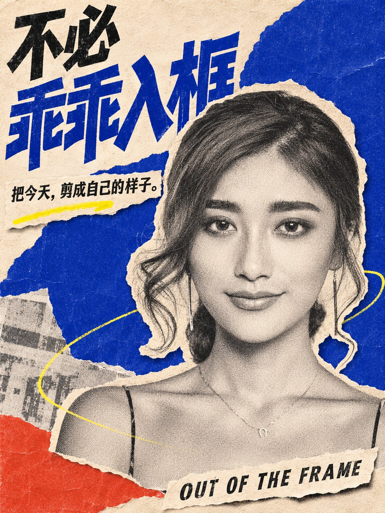
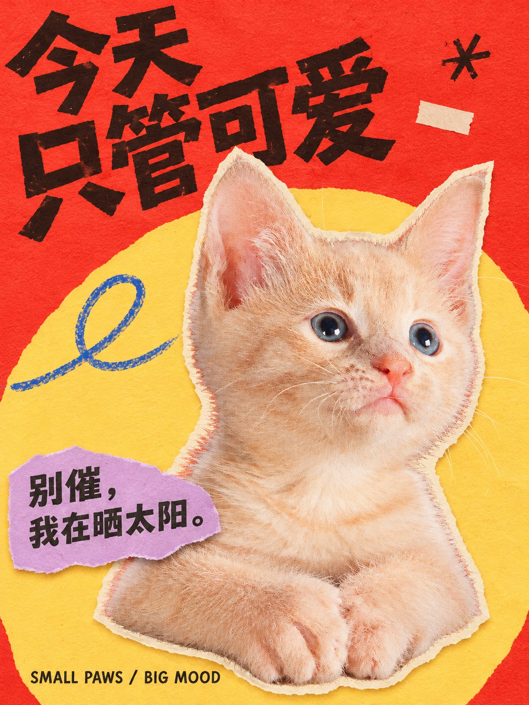

# visual-skills

**Give your agent a photo. Get a collage poster.**

The agent chooses the title, colors and composition. Choose **original-photo collage** or **AI creative editing** using your own host image tool. The first style is **Photo Collage**.

| Creative portrait | Creative pet |
|---|---|
|  |  |

Actual AI edits of the fixed test photos. Original ten outputs remain in the [legacy report](benchmark/REPORT.md).

[中文](README.md) · [All examples](benchmark/REPORT.md)

## Install and use

The project, skill and install package all use the name **`visual-skills`**. It currently supports photo collage. Scripts and fonts are included; install this single skill.

Tell Codex:

> Install `skills/visual-skills` from https://github.com/chingz0509/visual-skills and prepare its runtime.

Then attach a photo:

> Use visual-skills to turn this photo into a collage poster.

Include your own title if you have one. Otherwise, the agent writes it in your conversation language.

## What you get

- A 1200 × 1600 PNG poster.
- Original-photo mode without generative redrawing, or explicitly selected creative editing with identity and artifact review.
- Saved photos, layers and layout for local rendering. For an AI-generated poster, the actual flattened artwork, prompt and parameters are saved; its internal elements are not editable layers.

Works with portraits, groups, products, pets and landscapes. Group relationships and complete landscape photos are preserved. The baseline uses your existing agent and local tools; no extra image-generation key or additional skill is needed. On first use, the agent may download Python image-processing dependencies and needs permission to execute local tools.

## Experimental status

Verified environment: **Codex desktop on Apple Silicon macOS**. Other environments have not completed end-to-end validation.

`0.2.0-preview` adds creative editing and three local composition types. The user approved the displayed direction; full benchmark acceptance remains pending. A camera test failed on generated dial lettering. [Validation and limitations (Chinese)](docs/VALIDATION-0.2.md). Legacy success counts do not apply to this version. Creative editing requires an available host image tool or the user's configured image service; no author key or shared server is provided. [Legacy results, including rejected attempts →](benchmark/REPORT.md)

[Download visual-skills](https://github.com/chingz0509/visual-skills/releases/tag/v0.2.0-preview) · [Runtime details (Chinese)](docs/USAGE.md) · [Contribute a style](CONTRIBUTING.md) · [Changelog](CHANGELOG.md)

Code uses MIT. Photos and fonts retain their own licenses. [Credits](THIRD_PARTY.md)
