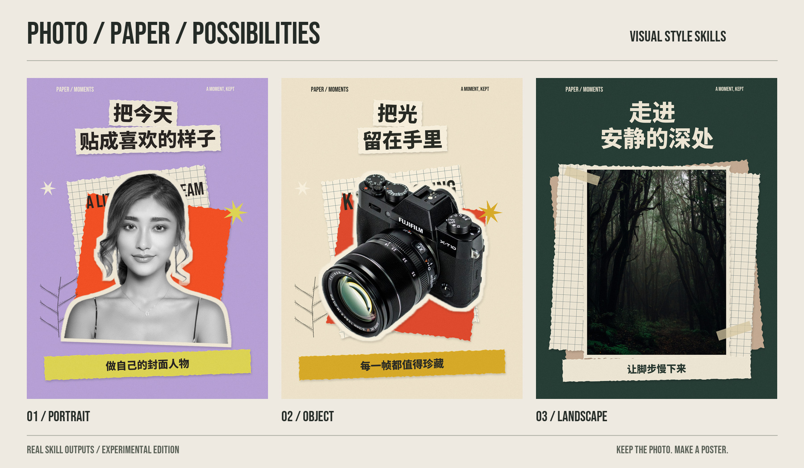

# Visual Style Skills · 视觉风格技能库

**给一张照片，让 Agent 把它设计成海报。** 保留照片中的你、物品和风景，用纸张、文字与印刷质感重新编排。



首个风格 **摄影剪贴拼贴** · 原片主体保真 · PNG + 可重合成素材包 · 基础流程无需生图密钥

*实验版本。上图选自当前 skill 的真实输出，仅重新编排展示；完整十张测试及被拒绝的中间结果均保留在[实验报告](benchmark/REPORT.md)。*

[安装与使用](#用户怎么用) · [完整案例](benchmark/REPORT.md) · [版本记录](CHANGELOG.md) · [贡献风格](CONTRIBUTING.md) · [English](README.en.md)

## 风格目录

| 风格 | 用途 | 状态 |
|---|---|---|
| [摄影剪贴拼贴](skills/photo-paper-collage/SKILL.md) | 原片、纸张叠层、中文标题、统一印刷质感 | `0.1.0-experimental`，Codex 桌面端开发验证 |

每个目录都是可单独安装的 skill。将来新增风格会列在这里，并附上各自的案例、适用环境和验证状态。

当前固定集 Agent 初检：8 张初次通过，2 张修复后通过；10 张均为复杂拼贴，简洁通过 0、最终失败 0。两次宠物抠图失败的中间结果完整保留。**用户最终验收待完成；这些结果不构成通用可用性或 100% 成功率承诺。** [完整报告与所有案例](benchmark/REPORT.md)

## 用户怎么用

在支持本地文件和命令执行、能够看图的 Agent 中安装本仓库的 `skills/photo-paper-collage`，然后上传图片，说：

> 用摄影剪贴拼贴，把这张照片做成海报。你来决定中文标题、配色和布局。

用户有正式文案时直接附上；没有则自动创作不含虚构事实的短句。默认 1200×1600 的 PNG，照片保真，不用生图密钥。Agent 自动准备依赖、做设计、检查和有限修复。

**推荐交给 Agent 安装。** 把本 GitHub 仓库链接发给 Codex，再说：

> 请安装这个仓库里的 `skills/photo-paper-collage`，并按 skill 的说明检查和准备运行环境。

也可从 [Releases](https://github.com/chingz0509/visual-style-skills/releases/tag/v0.1.0-experimental) 下载 `photo-paper-collage-0.1.0-experimental.zip`，解压后把文件夹交给 Codex 安装。只用这一种风格时下载独立 skill 包即可；源码包包含开发脚本和测试案例。

可以把仓库文件夹交给 Codex 并说“安装这里的摄影剪贴拼贴 skill”。开发者也可在仓库目录运行：

```bash
python3 scripts/install.py --prepare
```

安装到用户的 Codex skills 目录，遇到同名现有安装会停止，不覆盖。若当前对话没有刷新技能列表，新开对话使用，或让 Agent 直接读取安装后的 `SKILL.md`。

## 什么叫本地程序

它是跟 skill 一起提供的小工具，Agent 自动调用，用户不用学写程序或操作设计软件。Agent 负责看图和做设计决定；工具负责抠图、摆放原片、排字、绘制纸张和导出 PNG。原照片中的脸、姿势、产品等不会交给生图模型重绘。

- **聊天与视觉判断**：用用户正在使用的 Agent。
- **基础设计合成**：用户环境里的本地程序，无额外生图费用或作者服务器。
- **可选生图增强**：未来用用户宿主的图像工具或用户自己的服务生成装饰；首版未接入自定义生成素材接口。

## 支持范围

首个验证环境为 Codex 桌面端、Apple Silicon macOS 26.6.1。依赖准备会优先复用宿主可用的 Python；缺包时创建隔离环境。

macOS 14+ 且具备 Swift 命令行工具时，可用 Apple Vision 本地前景分割和 OCR。缺少分割工具时采用完整照片的复杂拼贴，不会要求生图密钥。安装、网络或宿主权限仍可能阻止自动准备；此时如实说明。Windows、Linux 和其他 Agent 尚未完整验收，不宣称跨平台开箱即用。

支持单人、合照、产品、宠物和风景。合照与风景保留完整照片。抠图不能可靠保留主体时，改为整图叠层。首版只有四种布局、四组配色、短文案；版式多样性和细毛边缘仍是局限。

## 输出和修复

每个任务保存原图、计划、三次以内的尝试、照片处理说明、图层、字体、检查、视觉意见、复现脚本与最终 PNG。

初次复杂拼贴 → 第一次修复 → 第二次使用完整原图的简洁拼贴 → 通过或失败。硬检查通过后仍需 Agent 实际看图。没有视觉检查的作品不算通过。

使用 bootstrap 返回的 Python 运行：

```bash
python scripts/replay.py /path/to/attempt-0 --output /path/to/replayed.png
```

这里的 `scripts/replay.py` 位于已安装 skill 内；也可使用输出包自带的 `replay.py`。已保存的图层可以逐像素重合成；重新调用模型不承诺同图。

## 项目结构

```text
skills/photo-paper-collage/  可独立安装的完整风格 skill
benchmark/                  调试前冻结的 10 张照片清单、计划、完整报告
examples/                   全部最终结果和被拒绝的中间结果
scripts/                    安装、固定集下载、评估与打包
tests/                     保真、复现、修复上限等行为检查
```

新增风格使用 `skills/<style-name>/`。每个风格包含审美规则、执行流程、素材/程序和自己的验证结果。当前不引入额外路由大 skill；共享程序等第二个风格出现真实复用需求时再抽取。[设计约定](docs/DESIGN.md) · [贡献风格](CONTRIBUTING.md)

代码与自制程序纹理采用 MIT；照片与字体遵循各自许可。参考海报仅用于审美讨论，不随开源包分发。[素材来源与许可](THIRD_PARTY.md)

维护者发布流程见 [发布指南](docs/PUBLISHING.md)。
