# 固定集实验报告 · eval-01

日期：2026-11-03。输入在渲染器实现与调试前冻结；五类各两张、一易一难。无失败换图。

这是当前 Codex 桌面端中的开发验证，由同一 Agent 写计划并逐图检查，不是独立盲测。项目发起人的最终验收仍为待完成。所有结果为实验结果，不据此宣称达到通用可用标准。

程序检查和 Agent 初检均通过后才计入。初次通过 8 张；两张宠物图因抠图问题被拒绝，第一次修复恢复完整原片后通过。复杂通过 10、简洁通过 0、最终失败 0。没有为凑齐状态而人为制造失败。第二次简洁降级与最终失败路径另有合成输入行为测试，不混入这 10 张的结果。

拟定门槛为至少 8/10 可用，其中至少 6/10 复杂通过。当前 Agent 初检达到该数值，**用户最终验收未完成，门槛尚未最终确认**。纸层、构图和字形仍有统一模板感，和参考图的自由编辑感存在差距。

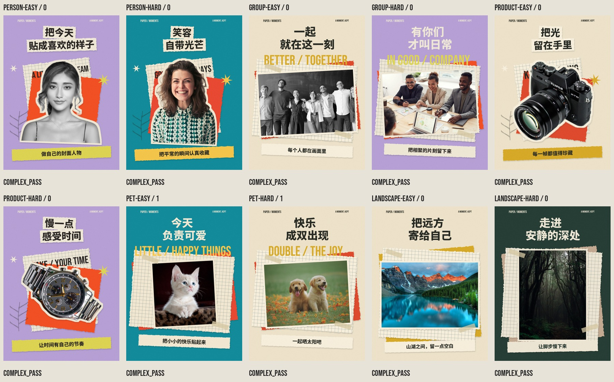

| 固定输入 | 初次结果 | 最终结果 | 尝试数 | 精确复现 | 用户验收 |
|---|---|---|---|---|---|
| person-easy | passed | complex_pass | 1 | True | 待验收 |
| person-hard | passed | complex_pass | 1 | True | 待验收 |
| group-easy | passed | complex_pass | 1 | True | 待验收 |
| group-hard | passed | complex_pass | 1 | True | 待验收 |
| product-easy | passed | complex_pass | 1 | True | 待验收 |
| product-hard | passed | complex_pass | 1 | True | 待验收 |
| pet-easy | rejected | complex_pass | 2 | True | 待验收 |
| pet-hard | rejected | complex_pass | 2 | True | 待验收 |
| landscape-easy | passed | complex_pass | 1 | True | 待验收 |
| landscape-hard | passed | complex_pass | 1 | True | 待验收 |

## 每张照片与完整尝试

原片、实际图层、字体和复现脚本在本地 `benchmark/runs/eval-01/` 中保留。公开目录保留成品与检查记录，原片按固定清单下载；完整素材包不在 Git 分发中。

来源许可及元数据更正见 [THIRD_PARTY](../THIRD_PARTY.md)。

### person-easy

单人，纯色背景，轮廓清楚

照片：Pixabay / [Pexels 415829](https://www.pexels.com/photo/woman-wearing-black-spaghetti-strap-top-415829/)。

**第 0 次尝试：passed** — 与原图并排检查：面容、耳饰、项链、肩带均保留；仅允许的黑白转换。发丝边界有轻微软化但无明显断裂。中文标题和副标题准确，纸层主次清楚。背景英文作为部分遮挡的装饰文字，不承载正式信息。

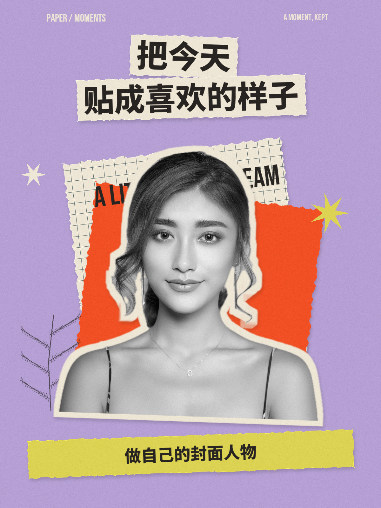

[计划](../examples/person-easy/attempt-0/plan.json) · [硬检查](../examples/person-easy/attempt-0/checks.json) · [视觉记录](../examples/person-easy/attempt-0/visual-review.json)

### person-hard

散发、纹理衣物、室内背景，头发细节较难

照片：Andrea Piacquadio / [Pexels 774909](https://www.pexels.com/photo/woman-in-collared-shirt-774909/)。

**第 0 次尝试：passed** — 面部、表情、衬衫图案保持原片；卷发主体保留，边缘少量透明细丝弱化，没有明显破洞。中文准确，照片与两层纸张形成清楚层次。

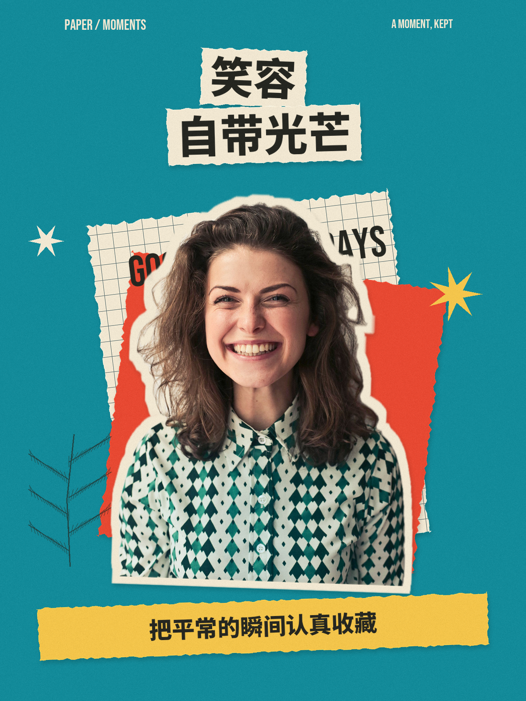

[计划](../examples/person-hard/attempt-0/plan.json) · [硬检查](../examples/person-hard/attempt-0/checks.json) · [视觉记录](../examples/person-hard/attempt-0/visual-review.json)

### group-easy

七人横向合照，边缘人物原本部分出框；必须保持原图全部可见区域

照片：fauxels / [Pexels 3184398](https://www.pexels.com/photo/people-taking-group-picture-3184398/)。

**第 0 次尝试：passed** — 整幅七人照片完整嵌入，左右两端原本已有出框，生成没有再裁人物。黑白为允许转换；标题副标题正确，纸层未遮挡脸。

[计划](../examples/group-easy/attempt-0/plan.json) · [硬检查](../examples/group-easy/attempt-0/checks.json) · [视觉记录](../examples/group-easy/attempt-0/visual-review.json)

### group-hard

多人前后遮挡、前景背影、桌面物品；所有人及关系需保留

照片：fauxels / [Pexels 3184338](https://www.pexels.com/photo/photo-of-three-people-smiling-while-having-a-meeting-3184338/)。

**第 0 次尝试：passed** — 三位正面人物和左下前景背影均保留，桌面与相对位置不变。整图嵌入，中文正确，照片与纸张和英文构成层次。

[计划](../examples/group-hard/attempt-0/plan.json) · [硬检查](../examples/group-hard/attempt-0/checks.json) · [视觉记录](../examples/group-hard/attempt-0/visual-review.json)

### product-easy

白底相机，外轮廓清楚，镜头及标识需保留

照片：Maddy Jaya / [Pexels 90946](https://www.pexels.com/photo/black-fujifilm-dslr-camera-90946/)。

**第 0 次尝试：passed** — 相机外壳、镜头、机身拨盘与标识都来自原片，轮廓无明显破损。中文标题和副标题完整；没有生成产品细节。

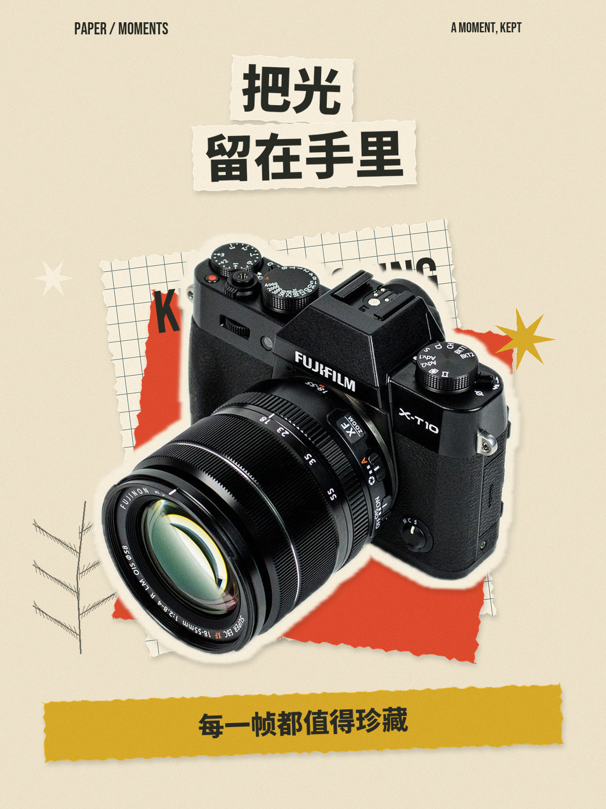

[计划](../examples/product-easy/attempt-0/plan.json) · [硬检查](../examples/product-easy/attempt-0/checks.json) · [视觉记录](../examples/product-easy/attempt-0/visual-review.json)

### product-hard

金属反光表链、复杂暗背景、细小表盘刻度

照片：Fernando Arcos / [Pexels 190819](https://www.pexels.com/photo/190819/)。

**第 0 次尝试：passed** — 对照原图，金属表链、表冠、表盘和按键保持；原照片已有的细小文字在缩放后清晰度有限，未重写。边缘干净，中文标题准确。

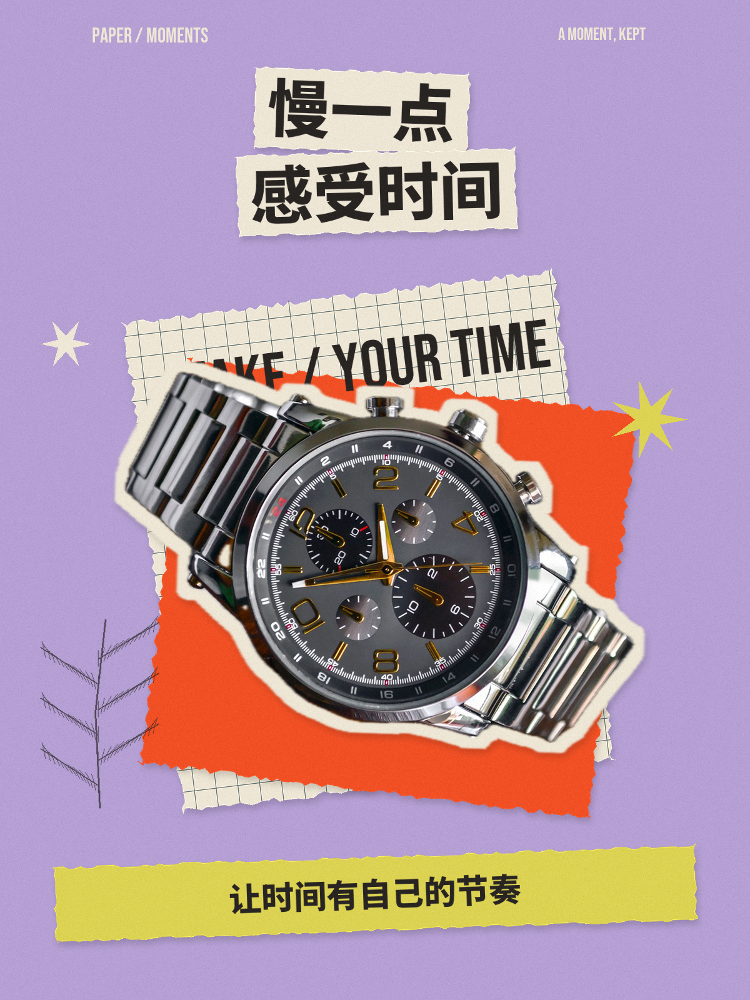

[计划](../examples/product-hard/attempt-0/plan.json) · [硬检查](../examples/product-hard/attempt-0/checks.json) · [视觉记录](../examples/product-hard/attempt-0/visual-review.json)

### pet-easy

单猫轮廓清楚，但有细毛和胡须

照片：Pixabay / [Pexels 45201](https://www.pexels.com/photo/45201/)。

**第 0 次尝试：rejected** — 不通过：猫咪左、右侧延伸至背景的多根胡须在抠图后明显消失。脸、耳与身体来自原片，但alpha保留不完整。应改为整图纸张拼贴，避免把RGB未改误当作主体完整。

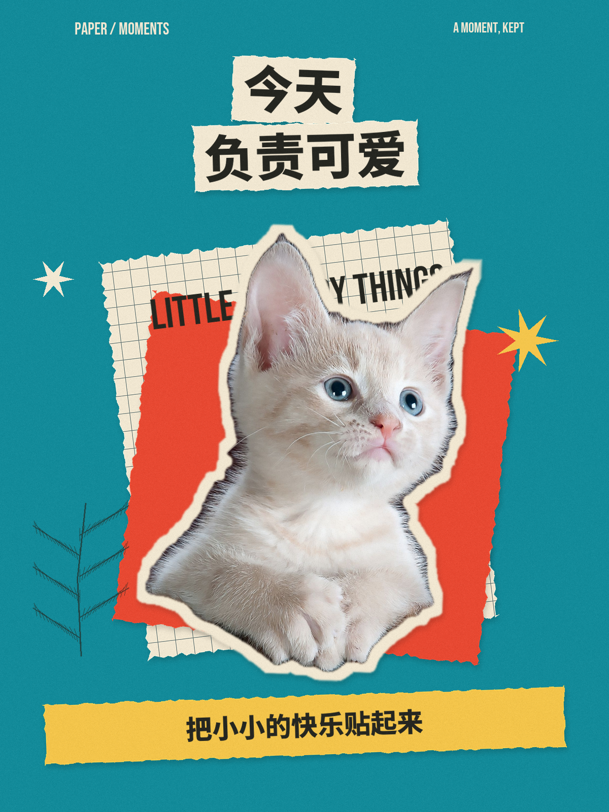

[计划](../examples/pet-easy/attempt-0/plan.json) · [硬检查](../examples/pet-easy/attempt-0/checks.json) · [视觉记录](../examples/pet-easy/attempt-0/visual-review.json)

**第 1 次尝试：passed** — 第一次修复改为完整原片：胡须、耳部细毛、前爪及原有垫子完整保留。中文准确，纸张/胶带/照片层次清楚。属于复杂整图拼贴，不是第二轮简洁降级。

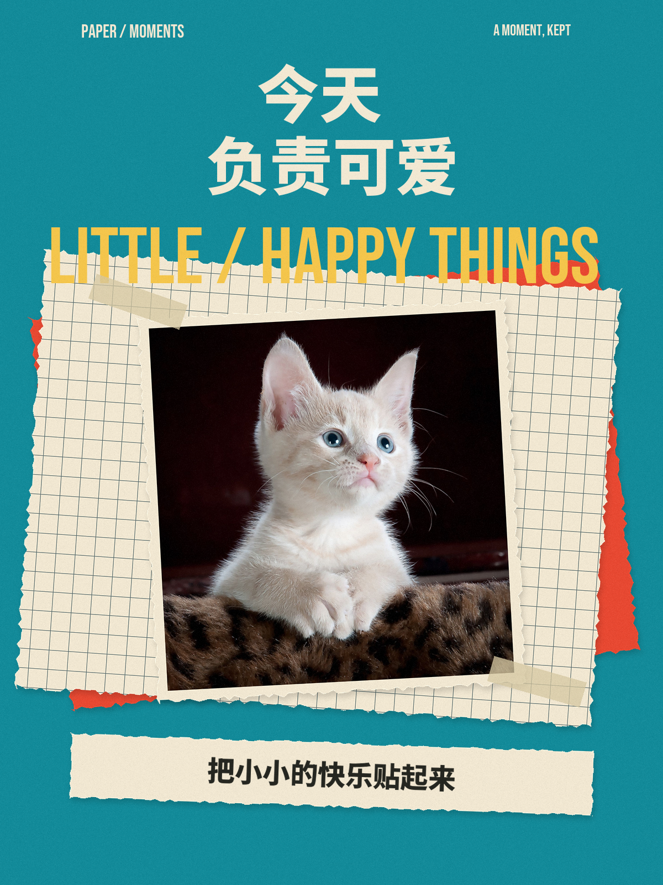

[计划](../examples/pet-easy/attempt-1/plan.json) · [硬检查](../examples/pet-easy/attempt-1/checks.json) · [视觉记录](../examples/pet-easy/attempt-1/visual-review.json)

### pet-hard

两只宠物相邻，毛发和草地花朵混杂；两只都需保留

照片：Chevanon Photography / [Pexels 1108099](https://www.pexels.com/photo/two-yellow-labrador-retriever-puppies-1108099/)。

**第 0 次尝试：rejected** — 不通过：两只狗面部保留，但脚边残留草叶花瓣，底部轮廓呈不自然的切口。整图重构能保留原始遮挡关系和毛发。

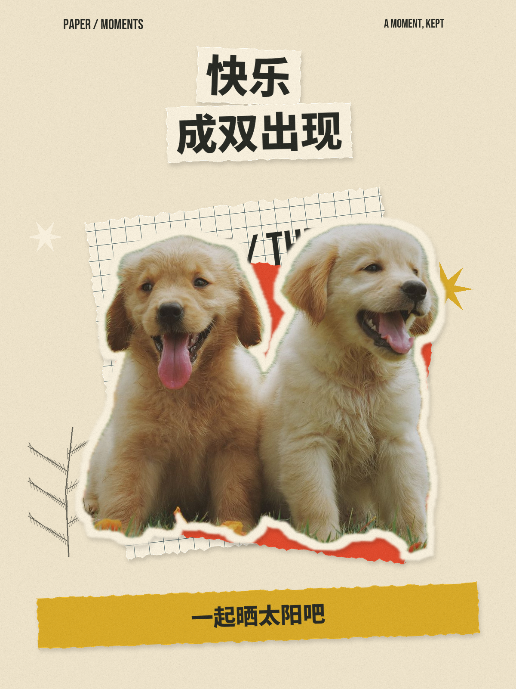

[计划](../examples/pet-hard/attempt-0/plan.json) · [硬检查](../examples/pet-hard/attempt-0/checks.json) · [视觉记录](../examples/pet-hard/attempt-0/visual-review.json)

**第 1 次尝试：passed** — 第一次修复改为完整原片：两只狗与草地的原始遮挡保留，脚边不再出现抠图切口。中文正确，整幅照片和两层纸张、胶带及标题形成清楚主次。

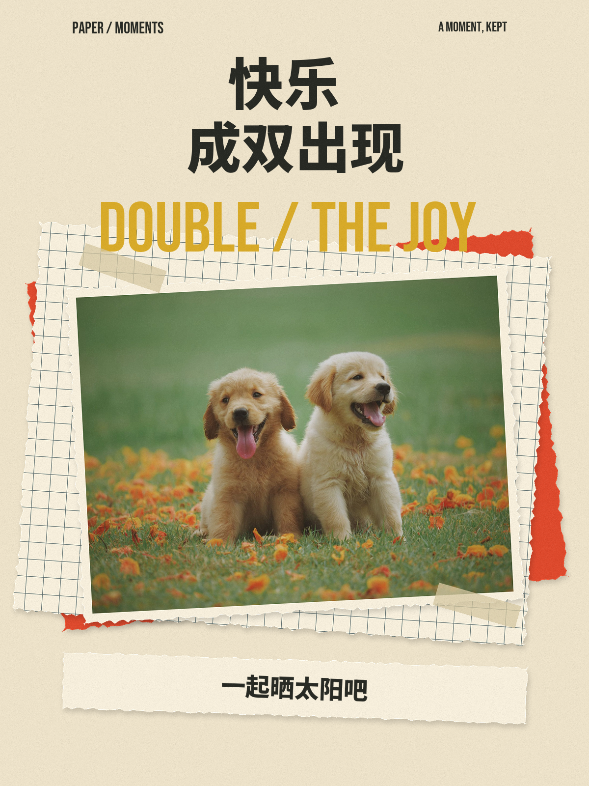

[计划](../examples/pet-hard/attempt-1/plan.json) · [硬检查](../examples/pet-hard/attempt-1/checks.json) · [视觉记录](../examples/pet-hard/attempt-1/visual-review.json)

### landscape-easy

横向明亮山湖，整图嵌入

照片：James Wheeler / [Pexels 417074](https://www.pexels.com/photo/lake-and-mountain-417074/)。

**第 0 次尝试：passed** — 横向整幅山湖保留，山峰、倒影、树线和左右边界均未重排。纸张、网格和标题形成三层关系；中文准确。

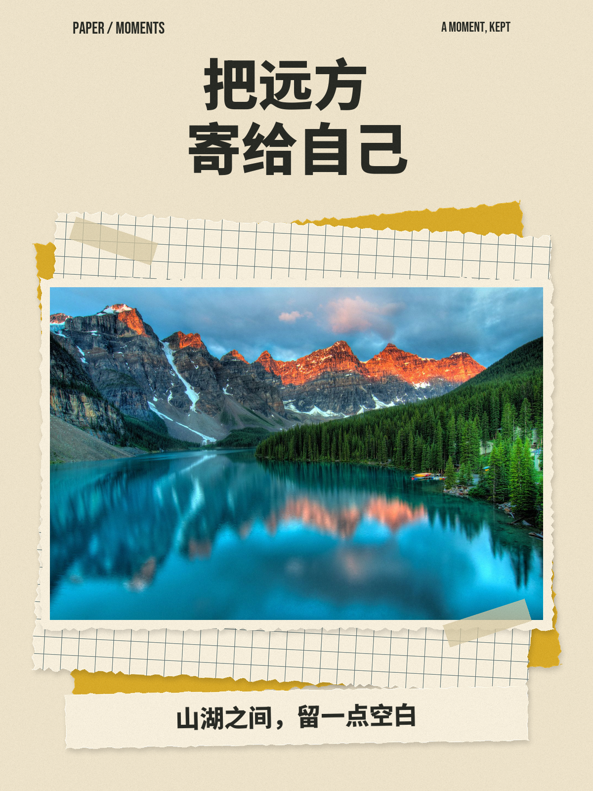

[计划](../examples/landscape-easy/attempt-0/plan.json) · [硬检查](../examples/landscape-easy/attempt-0/checks.json) · [视觉记录](../examples/landscape-easy/attempt-0/visual-review.json)

### landscape-hard

竖幅低照度密林，保留树木空间关系

照片：Francesco Ungaro / [Pexels 1671325](https://www.pexels.com/photo/trees-on-a-dark-forest-1671325/)。

**第 0 次尝试：passed** — 竖幅暗森林完整嵌入，树干及路径关系未变；深色原片未再压暗。标题副标题准确，暖色纸边与深绿形成对比。

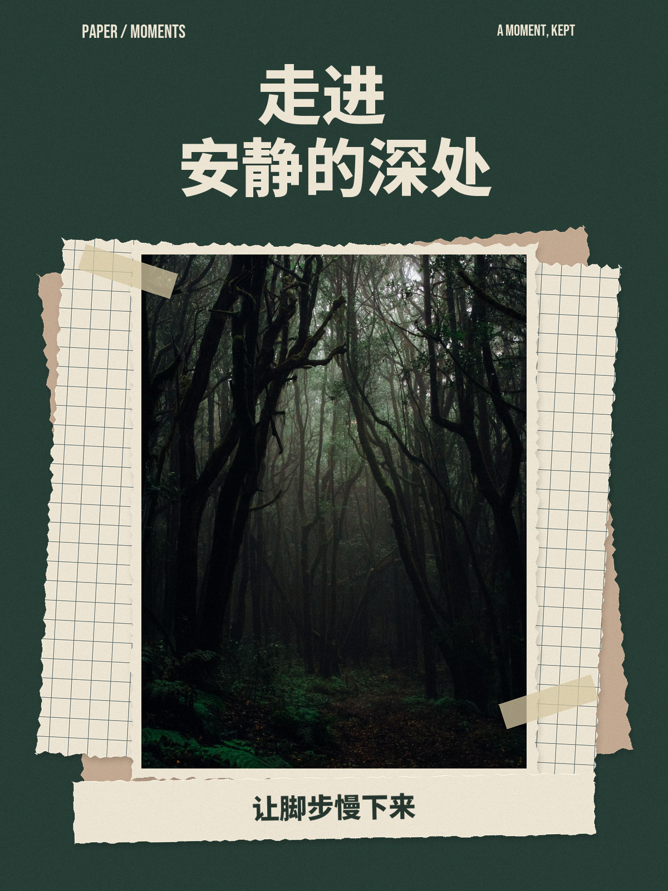

[计划](../examples/landscape-hard/attempt-0/plan.json) · [硬检查](../examples/landscape-hard/attempt-0/checks.json) · [视觉记录](../examples/landscape-hard/attempt-0/visual-review.json)

## 验证边界

- 10 个最终结果从保存图层重合成，逐像素一致。
- 6 项行为测试通过，覆盖原片 RGB 与边界、复现及篡改检测、三次尝试上限、简洁通过分类、正式文案保留、合照限制与防覆盖。
- 在当前机器复用已有 Python 依赖成功；没有声称空白机器的自动安装路径已全部验证。
- Apple Vision 分割和 OCR 仅在当前 macOS 环境验证。
- 当前版式固定 1200×1600、四种布局、短文案；不保证所有文字或图片都能得到满意结果。
- 视觉评审由作者 Agent 执行，可能存在审美偏差。用户可以逐项否决，并作为后续迭代证据。
