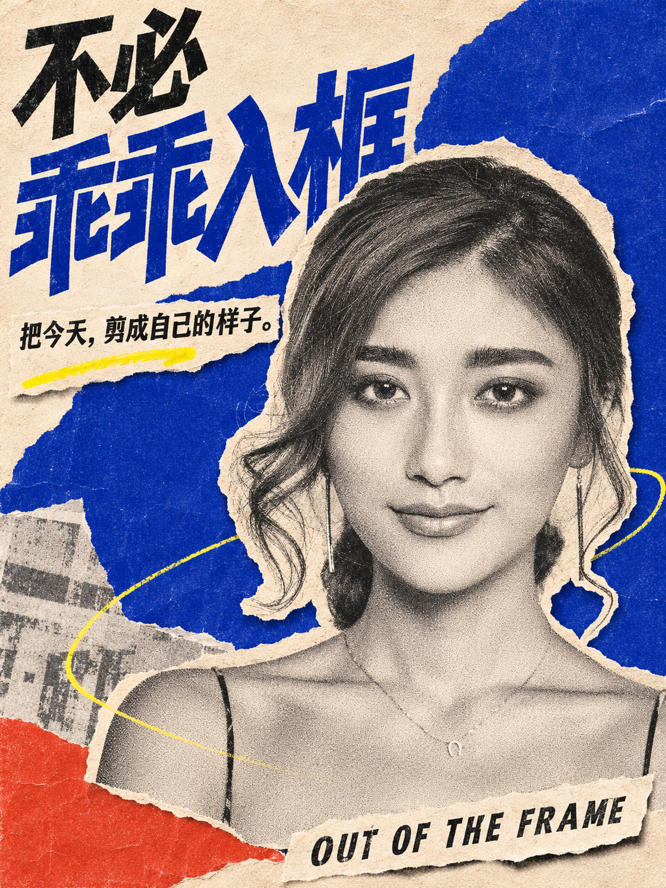
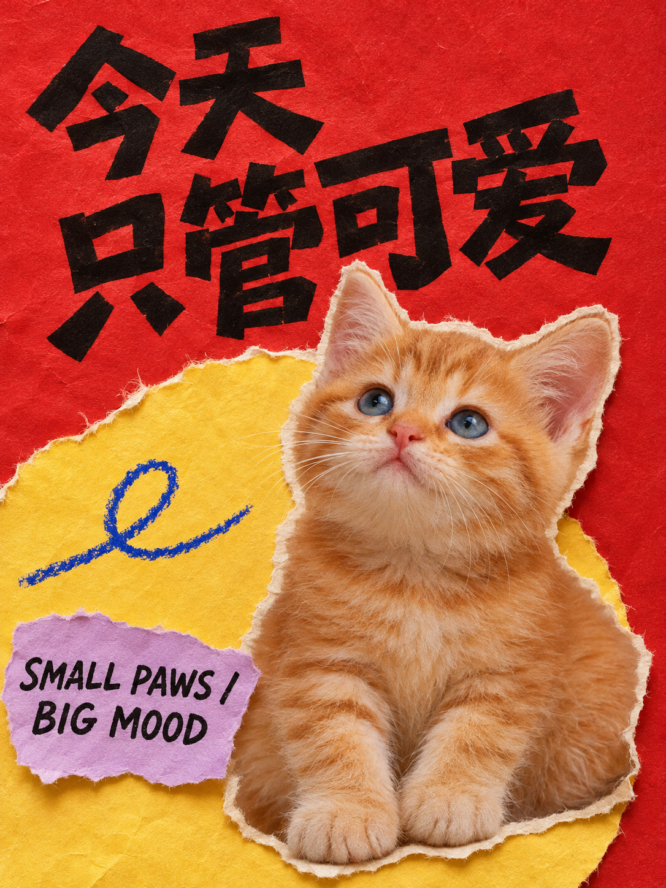
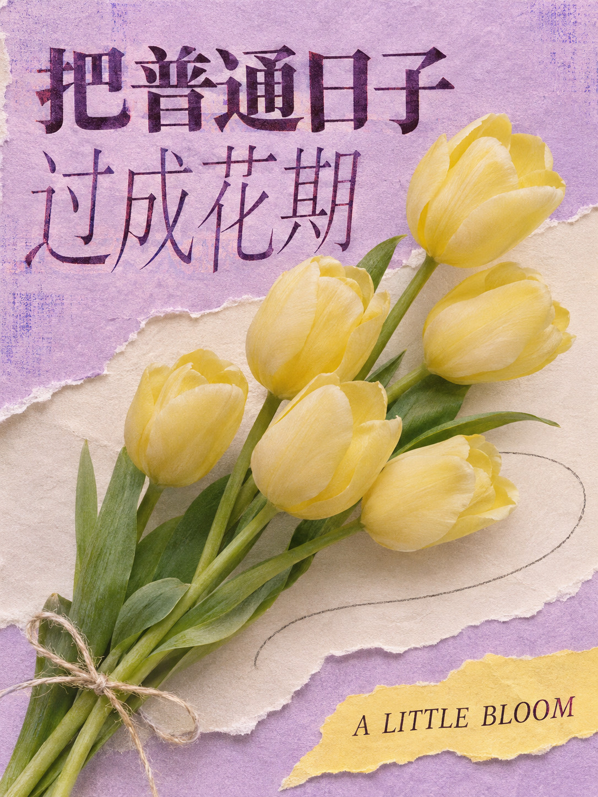
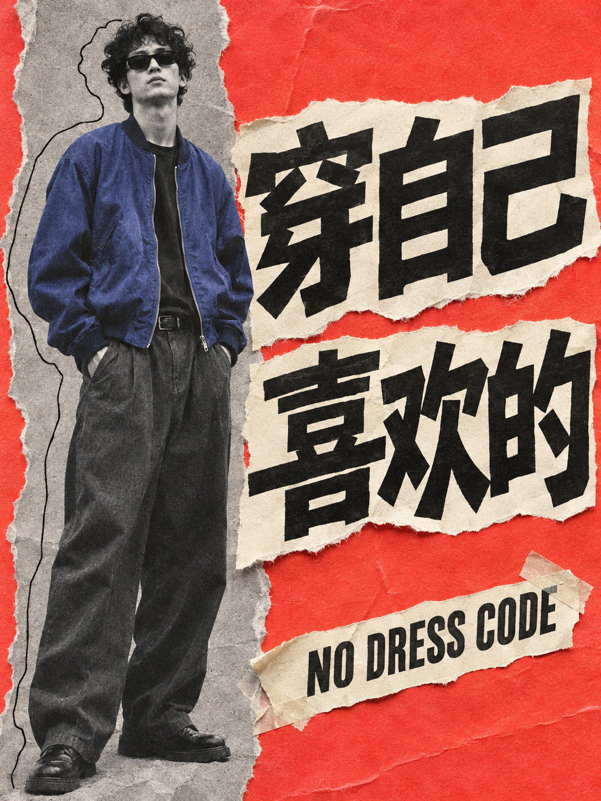
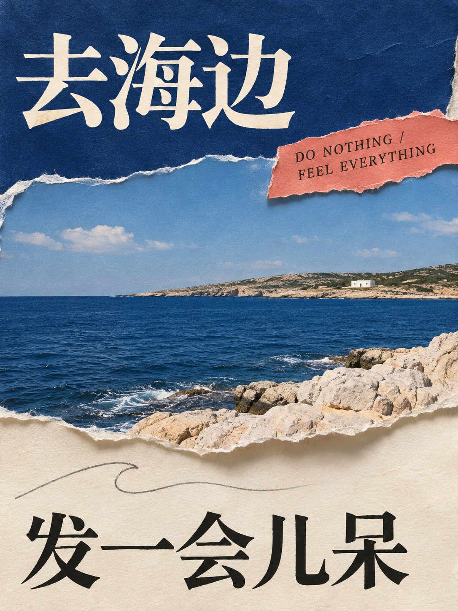

# 精选作品 / Selected works

[返回项目首页](../../README.md) · [English](../../README.en.md)

这五张展示摄影剪贴、撕纸、大字排版在不同主体上的变化。点击图片可查看完整尺寸 JPG。

## 人像 · 不必乖乖入框

## 宠物 · 今天只管可爱

## 花束 · 把普通日子过成花期

## 穿搭 · 穿自己喜欢的

## 风景 · 去海边发一会儿呆

## 制作说明 / Production notes

人像是基于固定测试照片 `person-easy` 做的 AI 创意改造，[照片来源与署名](../../THIRD_PARTY.md)及[生成记录](../v0.2.0-preview/portrait.json)已保留。其余四张使用 gpt-image-2 直接生成，用于展示设计方向；没有输入原始照片。它们不计入照片保真测试或成功率。

The portrait is an AI edit of the fixed `person-easy` photo. The other four posters were generated with gpt-image-2 to demonstrate the visual direction, without source photos. They are not photo-preservation benchmark results.

图片保留完整画面与原有比例，导出为适合网页展示的 JPG。五张均由用户选定用于项目展示。每张是平面成品，内部文字与纸片不可独立编辑。[尺寸、来源与生成信息](manifest.json)。
